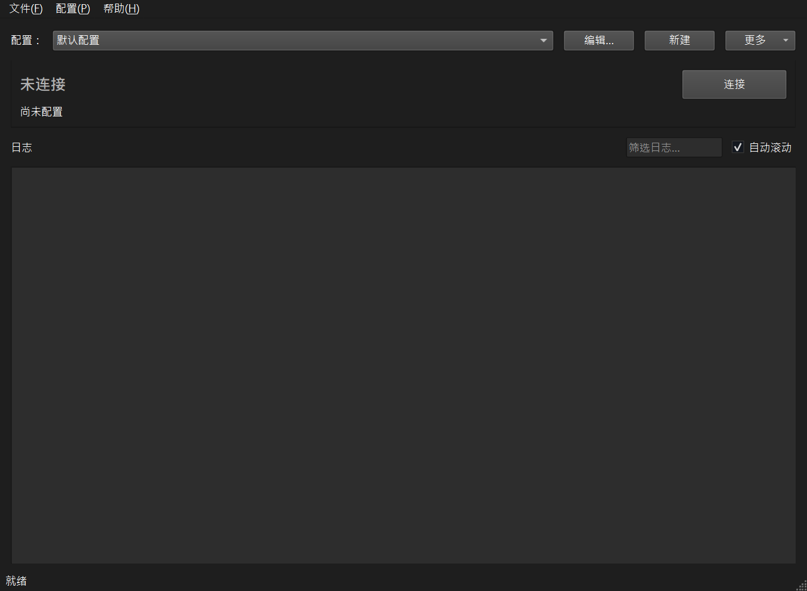
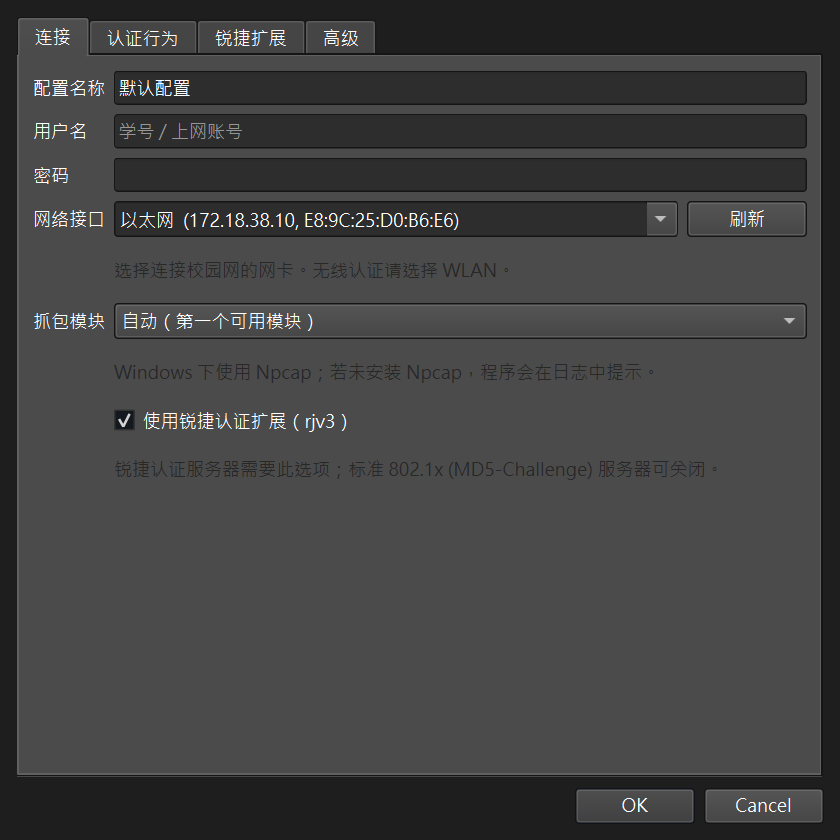
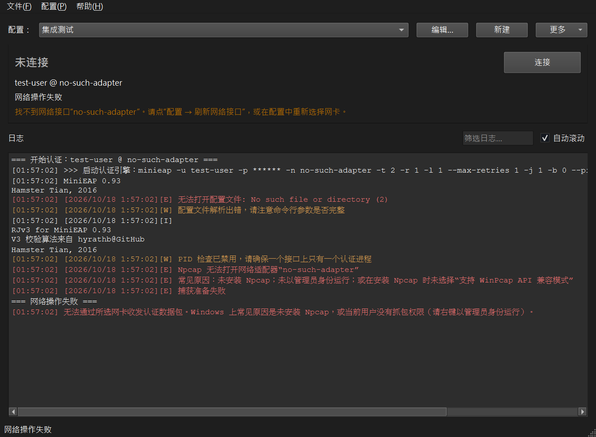

# MiniEAP Qt 图形界面

MiniEAP 原本是纯命令行的 802.1x 认证客户端。本目录新增的 Qt 6 前端让它可以在
Windows / Linux / macOS 上以图形方式使用，同时**完全复用原有的认证引擎**：命令行
客户端的行为没有改变。



---

## 1. 特性

- **跨平台**：Qt 6（Widgets）+ C11 引擎，同一套源码构建 Windows / Linux / macOS
- **配置管理**：多个命名配置，可保存、复制、编辑；每项设置对应一个命令行参数
- **实时日志**：按级别着色、可搜索、可保存 / 复制，参数中的密码自动打码
- **状态指示**：未连接 / 正在认证 / 已连接 / 失败，状态由引擎日志推导，不修改引擎
- **一键连接 / 断开**：引擎运行在后台线程，UI 不会卡死；断开是"请求 + 等待收尾"
- **网卡自动探测**：列出以太网 / 无线网卡（含 IP、MAC），虚拟网卡排在后面
- **认证方式兼容**：锐捷扩展（rjv3）可开关，标准 802.1x (MD5-Challenge) 也可用
- **内置自检**：`--screenshot`、`--profile-screenshot`、`--connect-test` 用于生成
  文档截图和端到端验证

| 连接配置 | 认证失败 |
|---|---|
|  |  |

---

## 2. 与命令行的关系

GUI 不重新实现认证逻辑。它把配置翻译成与 `minieap` 完全相同的参数，交给同一个
引擎执行，例如：

```
minieap -u 201000000 -p ****** -n 以太网 -t 5 -r 30 -l 3 --max-retries 3 -j 1 \
        -b 0 --pid-file none -e 30 -d 1 --module rjv3
```

编辑对话框中「高级」页会实时显示这条命令行，因此：

- 图形界面能做的事，命令行一定能复现（便于排查问题）；
- 原来的命令行用法、配置文件和 systemd 用法全部保持有效。

---

## 3. 构建

### 3.1 Windows（推荐 CMake + Qt 官方 llvm-mingw）

```powershell
cmake -S . -B build -G Ninja `
      -DCMAKE_C_COMPILER=C:/Qt/Tools/llvm-mingw1706_64/bin/x86_64-w64-mingw32-clang.exe `
      -DCMAKE_CXX_COMPILER=C:/Qt/Tools/llvm-mingw1706_64/bin/x86_64-w64-mingw32-clang++.exe `
      -DCMAKE_PREFIX_PATH=C:/Qt/6.10.0/llvm-mingw_64
cmake --build build
.\build\bin\minieap-qt.exe
```

> **工具链必须与 Qt 匹配。** Qt 官方的 Windows 包是用 libc++ 构建的，用它自带的
> llvm-mingw（clang + libc++）编译 C++ 部分即可；用 MSYS2 的 g++（libstdc++）链接
> 会在 `std::optional` 等符号上失败。

若不方便使用 CMake，仓库自带一个等价脚本：

```powershell
powershell -ExecutionPolicy Bypass -File scripts/build-windows.ps1
```

它会用 Qt 自带的 llvm-mingw 编译，并把 `Qt6*.dll`、`platforms/qwindows.dll`、
`libc++.dll` 等运行时复制到输出目录，产物在 `build-win\`：
`minieap.exe`（命令行）与 `minieap-qt.exe`（图形界面）。

### 3.2 Linux

```bash
sudo apt install build-essential cmake qt6-base-dev libpcap-dev   # Debian/Ubuntu
cmake -S . -B build
cmake --build build -j
./build/bin/minieap-qt
```

认证需要收发以太网帧，运行图形界面时需要用 root 或授予相应权限，二选一：

```bash
# 方式一：每次用 pkexec/sudo 运行
sudo ./build/bin/minieap-qt

# 方式二：给可执行文件授予原始套接字能力（推荐）
sudo setcap cap_net_raw,cap_net_admin=eip ./build/bin/minieap-qt
```

### 3.3 macOS

```bash
brew install cmake qt
cmake -S . -B build -DCMAKE_PREFIX_PATH="$(brew --prefix qt)"
cmake --build build -j
sudo ./build/bin/minieap-qt.app/Contents/MacOS/minieap-qt
```

### 3.4 只想要命令行

```bash
make                                  # 仍然生成 ./minieap，用法与以前完全相同
cmake -S . -B build -DMINIEAP_BUILD_GUI=OFF && cmake --build build
```

---

## 4. 平台依赖（请务必阅读）

| 平台 | 抓包模块 | 需要的东西 |
|---|---|---|
| Windows | `npcap` | [Npcap](https://npcap.com)；建议安装时勾选 **"Support WinPcap API-compatible Mode"**，否则需要以管理员身份运行 |
| Linux | `sockraw`（默认）/ `libpcap` | 原始套接字需要 root 或 `CAP_NET_RAW`；`libpcap` 需要 `-DMINIEAP_WITH_LIBPCAP=ON` |
| macOS | `bpf` | 需要 root |

Windows 上的抓包走 Npcap 的 WinPcap 兼容接口（`wpcap.dll`）。发布版**在运行时**
加载该 DLL：未安装 Npcap 时程序照常启动，日志会明确提示原因，而不是直接崩溃。
如果你有 Npcap SDK，可用 `-DMINIEAP_HAVE_PCAP_H=ON` 改用 SDk 的头文件。

---

## 5. 使用

1. 点「编辑…」，填写**用户名、密码**，选择**网络接口**（连接校园网的那块网卡；无
   线请选 WLAN）。
2. 锐捷校园网保持勾选「使用锐捷认证扩展」。标准 802.1x 服务器请取消勾选。
3. 点「连接」。顶部状态会依次显示：正在启动 → 正在认证 → 已连接。
4. 点「断开」停止；被服务器强制下线时会按配置自动重连（可在「认证行为」里关闭）。

常见问题：

- **提示 Npcap 无法打开适配器**：未安装 Npcap / 未以管理员身份运行 / 安装 Npcap
  时未选择兼容模式。
- **一直"正在认证"后超时**：网线或无线未连接、认证方式选错（锐捷 vs 标准）、
  账号密码错误。
- **认证失败次数达到上限**：引擎会主动退出，日志末尾会给出原因，可从「认证行为」
  页调整失败次数与重试次数。

---

## 6. 配置文件位置

| 平台 | 路径 |
|---|---|
| Windows | `%LOCALAPPDATA%\MiniEAP\MiniEAP\profiles.json` |
| Linux | `~/.config/MiniEAP/MiniEAP/profiles.json` |
| macOS | `~/Library/Preferences/MiniEAP/MiniEAP/profiles.json` |

窗口大小、自动滚动等界面状态由 Qt 的 `QSettings` 单独保存。配置文件包含密码，在
POSIX 上以仅属主可读（0600）权限写入；这**不是加密**，请妥善保管。

---

## 7. 实现说明（供修改代码者阅读）

GUI 与引擎之间的边界在 `include/bridge.h` 与 `src/bridge/bridge.c`：

- 引擎是单线程、阻塞式状态机，且失败路径直接调用 `exit()`。因此桥接层做三件事：
  1. 在**一条常驻工作线程**上运行引擎（`longjmp` 不能跨线程）；
  2. 用构建参数 `-Dexit=minieap_embedded_exit` 把引擎里的 `exit()` 重定向到
     桥接层，失败时 `longjmp` 回任务帧，UI 进程不会退出；
  3. 停止时先置标志让抓包循环返回，等待引擎在**工作线程**上完成收尾，再启动下一次。
- 日志通过 `g_minieap_log_hook` 直接回调给 GUI，逐行转发到界面线程（Qt 信号跨线程
  自动排队），不解析 stdout。
- `EngineBridge`（`gui/enginebridge.cpp`）负责 Qt 侧的线程调度与文本解码。

Windows 相关改动集中在：

- `if_impl/npcap/`：Npcap 抓包模块（`pcap_next_ex` 轮询，可随时响应停止）
- `src/bridge/pcap_dyn.c`：运行时加载 `wpcap.dll`
- `util/net_util_win32.c`：`GetAdaptersAddresses` / `GetNetworkParams` / 路由表
- `util/sched_alarm.c`：Windows 用定时器线程替代 `alarm()`/`SIGALRM`
- `util/pid_lock.c`：Windows 用命名互斥体替代 `flock()`
- `if_impl/if_impl.c`、`packet_plugin/packet_plugin.c`：Windows 使用显式注册表
  （PE 没有 `__start_`/`__stop_` 符号）

引擎本身的行为（认证流程、锐捷算法、参数含义）未做任何改动。

---

## 8. 版权

认证引擎：Hamster Tian (updateing)、Hu Yunrui 等人，遵循 GPL；
图形界面与平台适配同样遵循 GPL，详见 `LICENSE`。
